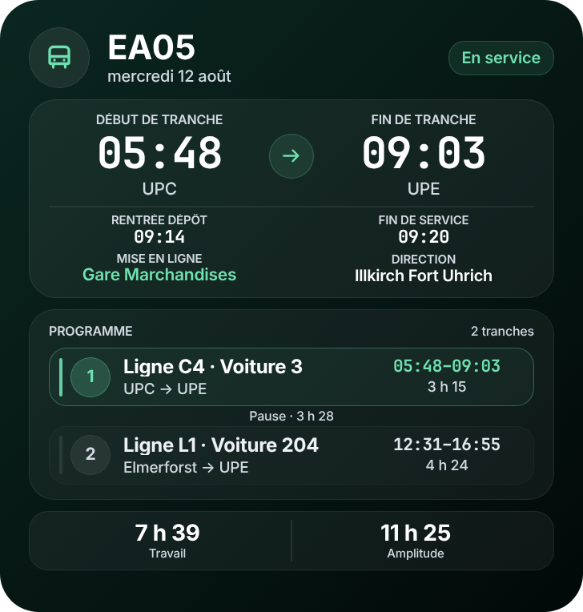
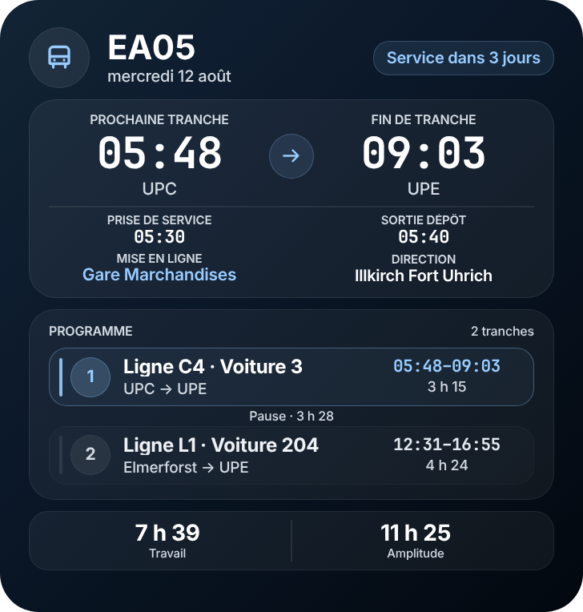
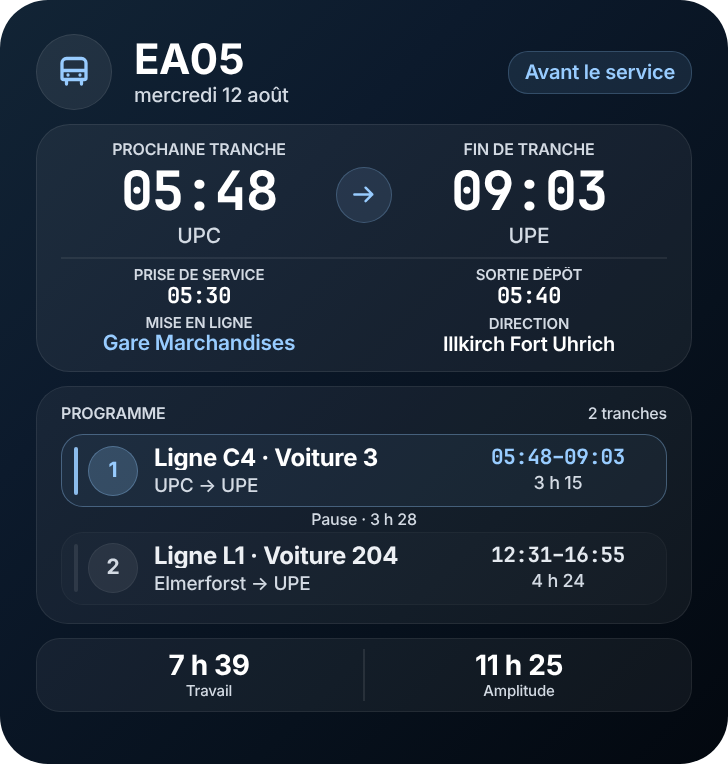
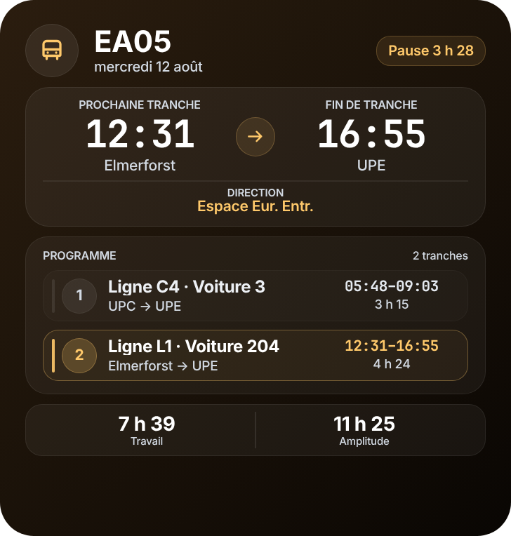
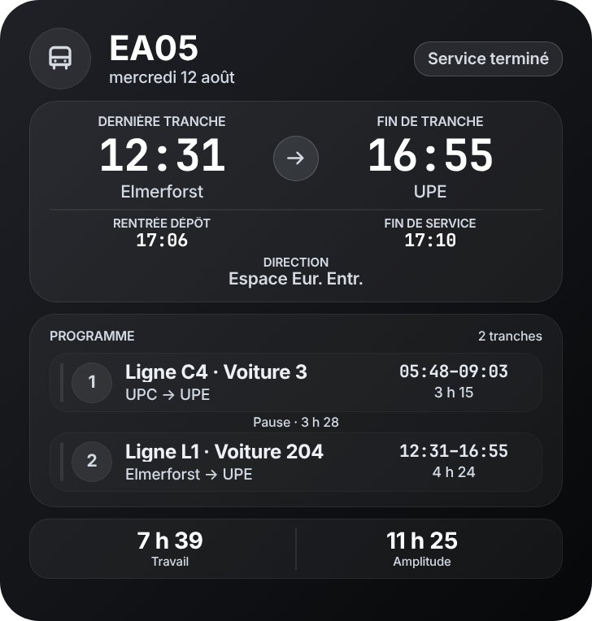
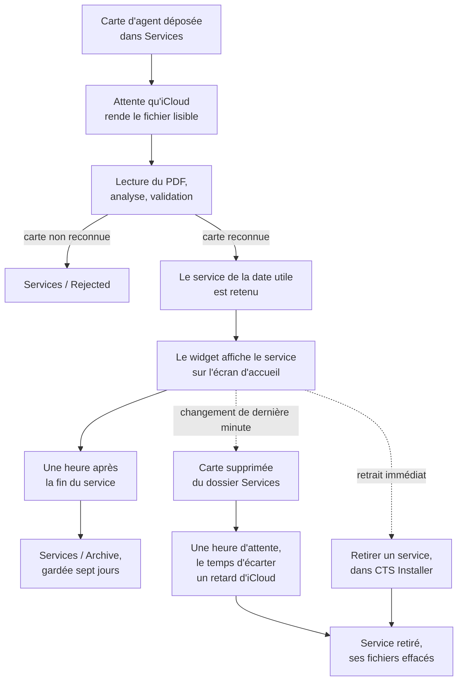
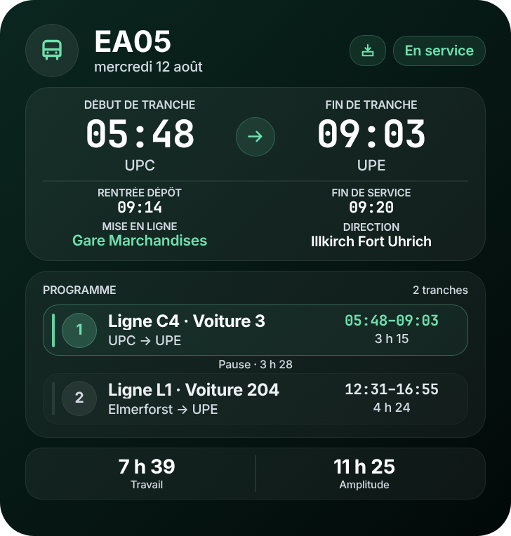
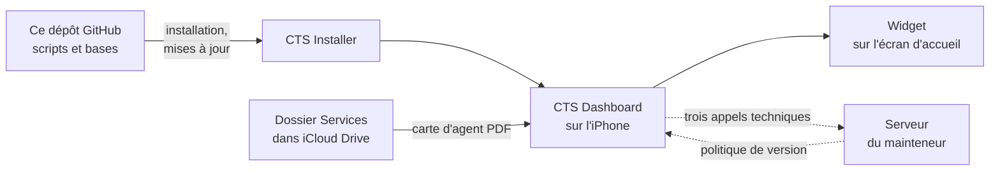

# CTS Dashboard

[](https://github.com/LASCAMPIA67/CTS-Dashboard/actions/workflows/validate.yml)
[](version.json)
[](version.json)
[](LICENSE)

Widget Scriptable pour iPhone : le conducteur CTS dépose sa carte d'agent
PDF, et son service du jour s'affiche sur l'écran d'accueil.

<p align="center">
  
</p>

**Développé et maintenu par Emilio IPPOLITO.**

> [!NOTE]
> CTS Dashboard est un projet indépendant. Les documents de service
> officiels restent la référence.

Ce README s'adresse à deux lecteurs. [Les conducteurs](#pour-les-conducteurs)
y trouvent l'installation et l'usage de chaque jour ;
[les responsables](#pour-les-responsables) y trouvent ce que le projet fait
des données et comment sa fiabilité est vérifiée. Le fonctionnement interne
du dépôt — numéros de version, vérifications automatiques — est décrit dans
[`CONTRIBUTING.md`](CONTRIBUTING.md).

## Ce que fait CTS Dashboard

Le conducteur dépose sa carte d'agent PDF dans un dossier iCloud. Tout le
reste est automatique : le widget lit la carte, retient le service du jour,
et affiche sur l'écran d'accueil ce qu'il reste à faire.

| | |
|---|---|
| **Import automatique** | les cartes d'agent PDF HASTUS sont lues sans aucune manipulation |
| **Sélection du service** | selon la date, y compris pour les horaires qui passent minuit |
| **États du service** | Service demain · Avant le service · En service · Pause · Coupure · Service terminé |
| **Programme détaillé** | tranches, lignes, voitures, directions, dépôts, mises en ligne, durées |
| **Retrait d'un service** | depuis le dossier `Services`, ou depuis CTS Installer |
| **Archivage** | une heure après la fin du service, archives gardées sept jours |
| **Taille du texte** | un réglage « Grandes polices », 25 % plus grand |
| **Résilience iCloud** | récupération des fichiers non encore synchronisés, avec nouvelles tentatives |
| **Réparation** | vérification et remplacement des fichiers abîmés |
| **Diagnostic** | rapport technique anonymisé, transmissible tel quel |

Le rendu s'adapte aux écrans iPhone plus étroits : il réduit les textes
longs avant d'en tronquer un, et resserre ses espacements plutôt que de
laisser déborder une colonne.

### Le widget, état par état

La couleur du widget dit d'un coup d'œil où en est la journée.

| | |
|:---:|:---:|
| <br>**Service à venir** — le prochain service connu, avec le nombre de jours qui en séparent | <br>**Avant le service** — la prise de service, la sortie du dépôt et la mise en ligne |
| <br>**En service** — la tranche en cours, la rentrée au dépôt et la fin de service | <br>**Pause** — sa durée, et la tranche qui suit |
| <br>**Coupure** — même lecture, quand la carte imprime une coupure | <br>**Service terminé** — la dernière tranche, la rentrée au dépôt et la fin de service |

Les images sont dessinées hors iPhone, par le code même qui dessine le
widget, sur un service inventé : aucune ne montre la carte d'un collègue.
La police diffère légèrement de celle de l'iPhone, la mise en page et les
couleurs sont celles du widget.

<details>
<summary>Ce que contient chaque bloc du widget</summary>

| Bloc | Ce qu'il montre |
|---|---|
| **En-tête** | le numéro de service, sa date, et une pastille qui dit l'état du moment |
| **Bandeau** | la tranche qui compte maintenant — à venir, en cours ou la dernière —, son début, sa fin et leurs lieux ; selon le moment, la prise de service et la sortie du dépôt, ou la rentrée au dépôt et la fin de service ; puis la mise en ligne et la direction |
| **Programme** | chaque tranche avec sa ligne, sa voiture, ses lieux, ses horaires et sa durée, la tranche active mise en avant, et entre deux tranches la pause ou la coupure qui les sépare |
| **Bas du widget** | **Travail**, la somme des tranches, et **Amplitude**, de la prise de service à la fin de la dernière tranche |

Un service qui compte une tranche de tram montre un tram dans l'en-tête, et
cette tranche affiche « Début exploitation » au lieu de « Mise en ligne ».
La direction est celle de la girouette quand la ligne le permet, et le
dernier arrêt desservi sinon.

</details>

## Pour les conducteurs

### Compatibilité

CTS Dashboard est conçu exclusivement pour **iPhone** et pour le **widget
grand format de Scriptable**.

| Ce qui est visé | Détail |
|---|---|
| **iOS 18** | sur les iPhone qui en restent à cette branche, dont XR, XS et XS Max |
| **iOS 26 et suivants** | sur le matériel qui les reçoit, à partir de l'iPhone 11 et de l'iPhone SE 2<sup>e</sup> génération |
| **Scriptable** | à jour, ce qui suppose iOS 15.5 ou ultérieur |
| **iCloud Drive** | activé pour Scriptable |
| **Internet** | requis pour l'installation, les mises à jour et la réparation des ressources — jamais pour l'affichage |

Les versions bêta d'iOS ne constituent pas une cible de garantie. Elles
peuvent être testées, mais la compatibilité officielle vise les versions
publiques récentes.

### Installation

#### 1. Obtenir CTS Installer

Rien ne s'installe à la main : un seul script, **CTS Installer**, met tout
le reste en place. Il se reçoit de deux façons, au choix.

| Source | Comment |
|---|---|
| **Le mainteneur** | il envoie le fichier `CTS Installer.scriptable` |
| **Un collègue** | qui a déjà le projet peut partager le même fichier depuis son iPhone |

Dans les deux cas, la mise en place est identique : ouvrir le fichier reçu,
puis **Partager → Scriptable → Add to My Scripts**.

#### 2. Installer le Dashboard

1. Installer **Scriptable** depuis l'App Store et l'ouvrir une première fois.
2. Ajouter `CTS Installer.scriptable` à Scriptable, comme ci-dessus.
3. Dans Scriptable, exécuter **CTS Installer**.
4. Toucher **Installer**, suivi du numéro de la version disponible, et
   attendre la validation complète — l'écran doit finir sur
   `22/22 fichiers valides`.

Si CTS Installer annonce une version plus récente **de lui-même**, il la
propose avant tout le reste : acceptez, puis fermez l'écran. Il se rouvre
seul et poursuit l'installation du Dashboard.

#### 3. Ajouter le widget

1. Sur l'écran d'accueil : **Modifier → Ajouter un widget**.
2. Choisir **Scriptable**, format **grand**.
3. Configurer le widget avec **Script : CTS Dashboard** et
   **When Interacting / Open App : Run Script**.

Selon la version d'iOS, le bouton de modification de l'écran d'accueil
porte un libellé ou une icône différente. La procédure qui vaut dans tous
les cas est **Modifier → Ajouter un widget**. Pour reconfigurer un widget
déjà en place : **appui long sur le widget → Modifier le widget**.

### Au quotidien

Une carte d'agent suit toujours le même chemin, du dossier `Services`
jusqu'aux archives. Une seule chose est à faire — déposer le PDF ; tout le
reste arrive tout seul.



#### Déposer un service

Enregistrer la carte d'agent PDF dans :

```text
iCloud Drive
└── Scriptable
    └── CTS Dashboard
        └── Services
```

Plusieurs cartes peuvent être déposées à l'avance. CTS Dashboard importe et
sélectionne automatiquement le service correspondant à la date utile.

Trois tutoriels détaillent ce dépôt selon le navigateur qui a servi à
télécharger la carte :

| Navigateur | Tutoriel |
|---|---|
| Safari | [Ouvrir le tutoriel](https://www.icloud.com/notes/03b7ney7MO0qzOmwsNGz19FGg) |
| Google | [Ouvrir le tutoriel](https://www.icloud.com/notes/0e4kWSTPvql3PyV_V62pH1lFg) |
| Brave | [Ouvrir le tutoriel](https://www.icloud.com/notes/052duaGDd5AYQILjAeLPS067g) |

#### Une carte en attente de lecture

Le widget ne s'accorde qu'un temps limité à chaque réveil, et la lecture
d'un PDF peut ne pas y tenir. Quand une carte attend encore d'être lue alors qu'un
service est déjà affiché, une petite icône de plateau apparaît dans
l'en-tête, à côté de la pastille d'état. Sans service à afficher, le widget
dit « Lecture en attente ».

La carte sera reprise automatiquement au réveil suivant. **Toucher le
widget** la fait lire tout de suite, dans l'application.

<p align="center">
  
</p>

#### Retirer un service

Quand un service change au dernier moment, l'ancien peut être retiré de
deux façons.

**Supprimer la carte d'agent du dossier `Services` suffit.** CTS Dashboard
le constate, retire le service et efface les fichiers qu'il avait produits.
Il patiente une heure avant de conclure, le temps de distinguer une
suppression volontaire d'un fichier qu'iCloud n'a pas encore synchronisé.

**Pour un retrait immédiat**, exécuter **CTS Installer** puis **Retirer un
service** : la liste indique le service affiché en ce moment, et demande
confirmation avant de supprimer.

Dans les deux cas, seuls les fichiers du service retiré sont supprimés. Les
autres services et les archives ne sont pas touchés.

#### Régler la taille du texte

Dans **CTS Installer → Taille du texte**, deux réglages :

| Réglage | Ce qu'il change |
|---|---|
| **Standard** | toutes les informations, texte de taille habituelle |
| **Grandes polices** | texte 25 % plus grand ; les détails du dépôt et de la direction sont masqués pour faire la place |

#### Structure créée automatiquement

Aucun de ces dossiers n'est à créer soi-même, et un seul se manipule :
`Services`.

```text
CTS Dashboard
├── Cache
├── Data
├── Database
└── Services
    ├── Archive
    └── Rejected
```

Les deux fichiers de PDF.js, qui servent à lire la carte agent, ne sont pas
dans iCloud : CTS Installer les pose dans le stockage propre à Scriptable sur
l'iPhone, invisible dans l'app Fichiers. iOS ne peut pas les en retirer faute
de place, comme il le faisait dans iCloud, et le widget n'a donc jamais à les
attendre au moment de lire une carte.

### Mises à jour

Relancer **CTS Installer**. Quand une version plus récente existe, le menu
propose **Mettre à jour vers**, suivi de son numéro ; sinon, **Vérifier les
fichiers** compare les 22 fichiers distribués à ceux que publie GitHub. Dans
les deux cas, les PDF, les archives et les données protégées sont conservés.

#### Deux règles, volontairement différentes

Deux mécanismes encadrent les versions, et ils ne suivent pas la même
logique.

**Dans CTS Installer, la mise à jour est obligatoire.** Si une version plus
récente existe, l'installateur la propose avant tout le reste et le menu
n'est pas accessible tant qu'elle n'est pas faite.

Le **Diagnostic** reste joignable sans mettre à jour : c'est la procédure
d'assistance du projet, et elle doit rester utilisable même quand c'est la
mise à jour qui échoue.

**Dans le widget, seul un plancher bloque.** `minimumDashboard`, dans
[`version.json`](version.json), fixe la version en dessous de laquelle le
widget cesse d'afficher un service et affiche « Mise à jour requise ». Une
version simplement en retard continue de fonctionner : couper un conducteur
en service parce qu'une correction vient de paraître n'aurait pas de sens.

Le widget ne consulte jamais le réseau pour en décider. Il lit une politique
déposée par l'appel d'activité quotidien, et **l'absence de réponse ne
bloque jamais** : sans réseau, sans politique connue ou à la première
installation, il fonctionne normalement.

#### Réparer un installateur bloqué

Si CTS Installer s'arrête sur **Opération impossible** avant d'avoir affiché
sa liste de fichiers — hors refus de GitHub, que l'alerte dit comme tel —,
c'est l'installateur lui-même qui est en cause, et il ne peut pas se
remplacer tout seul. Le script **CTS Repair** existe pour ce
seul cas :

1. ouvrir le fichier [`CTS Repair.js`](CTS%20Repair.js) du dépôt, puis
   **Partager → Scriptable → Add to My Scripts** ;
2. exécuter **CTS Repair** : il télécharge la version publiée de CTS
   Installer, la contrôle et la réécrit ;
3. relancer **CTS Installer**, choisir **Vérifier les fichiers** ;
4. supprimer **CTS Repair**, devenu inutile.

CTS Repair ne touche à aucune donnée : ni PDF, ni archives, ni index. Il
refuse d'installer un fichier incomplet ou porteur du même défaut, et remet
l'ancien installateur en place si l'écriture échoue.

### En cas de problème

#### Dépannage rapide

| Ce qui se passe | Quoi faire |
|---|---|
| Le widget affiche « Aucun PDF » | déposer la carte d'agent dans `Services` ; si elle y est déjà, attendre qu'iCloud finisse de la synchroniser, puis toucher le widget |
| Le widget affiche « Lecture en attente », ou l'icône de plateau | rien n'est perdu : la carte sera lue au réveil suivant, ou tout de suite en touchant le widget |
| Le widget affiche « Synchronisation iCloud » | rien à faire : la liste des services n'est pas encore arrivée sur cet iPhone, et le widget réessaie tout seul |
| Le widget affiche « Aucun service exploitable » | la carte déposée n'a pas été reconnue : vérifier que c'est bien une carte d'agent PDF, puis lancer **Diagnostic** |
| Le widget affiche « Mise à jour requise » | lancer CTS Installer et accepter la mise à jour : la version installée est passée sous le plancher |
| CTS Installer s'arrête sur « Opération impossible » et dit que votre installation n'est pas en cause | rien n'est en panne : relancer CTS Installer plus tard, à l'heure indiquée s'il en donne une, ou tout de suite en passant du Wi-Fi aux données mobiles |
| CTS Installer refuse de se lancer, ou s'arrête sur « Opération impossible » pour une autre raison | [réparer un installateur bloqué](#réparer-un-installateur-bloqué) |
| Un service retiré réapparaît | la carte est encore dans `Services` : la supprimer, ou passer par **Retirer un service** |
| Un refus temporaire de GitHub pendant une mise à jour | couper le Wi-Fi, puis relancer CTS Installer |
#### Diagnostic

Quand le dépannage rapide ne suffit pas :

1. exécuter **CTS Installer** ;
2. ouvrir **Diagnostic** ;
3. copier le rapport technique ;
4. transmettre ce rapport dans le canal d'assistance du projet.

Le rapport est conçu pour exclure le nom du conducteur, le matricule, les
horaires, le numéro de service et le contenu des PDF. Il peut donc être
transmis tel quel, sans relecture.

#### Où obtenir de l'aide

L'assistance passe par le groupe WhatsApp du projet, celui-là même où sont
publiées les notes de chaque version. Un rapport de diagnostic y suffit
presque toujours à identifier la panne.

Une faille de sécurité ne s'écrit pas là, ni dans une issue publique :
[`SECURITY.md`](SECURITY.md) dit par où la signaler.

#### Désinstaller

**CTS Installer → Désinstaller** retire le Dashboard. Les cartes d'agent PDF
et leurs archives sont conservées.

## Pour les responsables

Cette partie s'adresse à qui veut comprendre le projet avant de le laisser
s'installer : comment il est construit, ce qu'il fait des données, et
comment sa fiabilité est vérifiée.

### Comment le projet est construit

Tout tourne sur l'iPhone du conducteur, dans l'application Scriptable. Le
dépôt GitHub distribue les scripts, iCloud apporte la carte d'agent, et un
serveur tenu par le mainteneur reçoit trois appels techniques.



La carte d'agent est lue sur le téléphone, par PDF.js, et son contenu n'en
sort pas : seuls le nom et le matricule qu'elle porte accompagnent la
télémétrie, comme le détaille la section suivante. Aucun compte propre au
projet n'est à créer, et l'affichage ne dépend jamais du réseau.

### Données et confidentialité

Cette section dit exactement ce que les trois appels emportent, parce qu'un
dépôt public destiné à des collègues n'a pas à le laisser deviner.

#### Ce qui sort du téléphone

| Donnée | Quand | Ce que c'est |
|---|---|---|
| `installationId` | à chaque appel | un identifiant tiré au hasard à la première exécution et conservé dans le Keychain. Il ne dit rien de l'appareil ni de son propriétaire. |
| `dashboardVersion` | à chaque appel | la version installée |
| `iosMajorVersion` | à chaque appel | le numéro majeur d'iOS — `18`, `26` — jamais la version complète |
| `driverName`, `driverId` | avec la télémétrie, **depuis la 1.4.0** | le nom et le matricule **tels que la carte d'agent les porte** |
| Le déroulé de l'exécution | à chaque exécution, depuis le widget ou depuis l'application | si elle vient du widget ou de l'application, son état — réussite, avertissement, erreur —, sa durée, et l'issue de cinq étapes : lecture du PDF, analyse, sélection, rendu, archivage |
| Les incidents | quand il y en a | un code (`PDF_NOT_FOUND`), un module, une étape, une gravité. Jamais de message libre, jamais de texte saisi. |

> [!IMPORTANT]
> Le nom et le matricule ne sont **demandés à personne** : ils sont lus sur
> la carte d'agent, que le widget lit déjà. Un poste qui n'importe plus de
> carte n'en transmet aucun.

Ils n'avaient jamais quitté l'iPhone avant la 1.4.0 ; ils l'accompagnent
désormais pour que la console du mainteneur nomme un collègue au lieu de le
désigner par un code.

#### Ce qui n'en sort jamais

Les horaires, le numéro de service, les lignes, les arrêts, le contenu de la
carte d'agent, les archives, la position de l'appareil, et le contenu du
Keychain.

#### À quel rythme

| Appel | Quand |
|---|---|
| `/register` | une fois, à la première exécution, puis seulement si le jeton local est perdu |
| `/activity` | une fois par jour au plus, avec au moins une heure entre deux tentatives échouées |
| `/telemetry` | à chaque exécution |

Aucun de ces appels n'est bloquant : un serveur injoignable ne retarde ni
n'empêche l'affichage. C'est aussi par la réponse de `/register` et de
`/activity` que voyage la politique de version — donc sans un seul appel
réseau supplémentaire.

### Comment la fiabilité est vérifiée

Un outil consulté avant une prise de service ne doit pas tromper le
conducteur. Quatre garde-fous y veillent.

| Garde-fou | Ce qu'il garantit |
|---|---|
| **Une validation à chaque modification** | la syntaxe, le manifeste, la cohérence des numéros de version et le contraste des couleurs sont contrôlés à chaque poussée et à chaque pull request |
| **Vingt bancs d'essai** | rejoués au même moment, ils exécutent réellement les scripts hors iPhone, sur des doublures de Scriptable ; chacun est né d'un défaut réel, pour qu'il ne revienne pas |
| **Une installation vérifiée** | un fichier téléchargé n'est mis en place qu'une fois contrôlé, et la copie en place est conservée sinon |
| **Une carte douteuse est refusée** | une carte dont une tranche ne se lit pas est écartée et signalée, plutôt qu'affichée amputée |

Le détail des contrôles et des numéros de version est dans
[`CONTRIBUTING.md`](CONTRIBUTING.md), et les choix structurants du projet,
datés et justifiés, dans [`DECISIONS.md`](DECISIONS.md).

### Ce que contient ce dépôt

Ce dépôt est **public** et ne contient que ce qui est destiné aux
conducteurs.

| | |
|---|---|
| **22 fichiers distribués** | 17 scripts + 5 ressources, listés dans [`version.json`](version.json), installés par CTS Installer |
| **`CTS Installer.js`** | téléchargé depuis l'URL brute, se met à jour lui-même, hors manifeste |
| **`CTS Repair.js`** | remplace un installateur bloqué, installé à la main en cas de besoin |
| **`tools/preview/`** | bancs d'essai et outils de mesure, exécutés hors iPhone |
| **`docs/images/`** | les images de ce README, jamais installées sur un iPhone |
| **`.github/`** | la validation, les workflows qui la lancent, et le gabarit de pull request |
| **`LICENSE`** | la licence MIT du projet |

<details>
<summary>Les 22 fichiers, et ce que chacun fait</summary>

| Fichier | Rôle |
|---|---|
| `CTS Dashboard.js` | point d'entrée du widget |
| `CTS Config.js` | chemins, arborescence, constantes partagées et `DASHBOARD_VERSION` |
| `CTS Widget Engine.js` | assemble le contexte affiché et décide du prochain rafraîchissement |
| `CTS Widget Renderer.js` | dessine le widget, et choisit sa densité |
| `CTS Widget Theme.js` | palettes et couleurs, un jeu par état |
| `CTS Importer.js` | façade de l'import : délègue au pipeline |
| `CTS Import Pipeline.js` | enchaîne lecture, analyse, validation et rangement d'une carte |
| `CTS PDF Engine.js` | lit le PDF, en s'appuyant sur PDF.js |
| `CTS Parser.js` | extrait de la carte HASTUS le service, ses tranches et son conducteur |
| `CTS Service.js` | un service et ses tranches : état courant, statistiques, interruptions |
| `CTS Services Manager.js` | détecte les cartes déposées, tient l'index, choisit le service utile |
| `CTS Services Cleaner.js` | archive, purge, retire un service, classe les résidus d'écriture |
| `CTS Database.js` | résout les codes en noms de lignes, arrêts et lieux |
| `CTS Storage.js` | lit et écrit dans iCloud avec nouvelles tentatives ; seul à lire l'index des services, il porte aussi les préférences et la politique de version |
| `CTS Utils.js` | primitives partagées : temps, dates, texte, et les attentes bornées |
| `CTS Resources.js` | vérifie que les bases et PDF.js sont bien en place |
| `CTS Analytics Client.js` | les trois appels réseau, et eux seuls |
| `lines.json` | noms des lignes, et terminus de celles dont chaque trajet va de l'un à l'autre, relevés dans les horaires publiés par la CTS (`opendata.cts-strasbourg.eu`, 22/09/2026) |
| `stops.json` | noms des arrêts |
| `places.json` | noms des lieux du bandeau horaires |
| `pdf.min.mjs` | PDF.js |
| `pdf.worker.min.mjs` | PDF.js, moteur de lecture |

</details>

#### Les documents de travail

| Fichier | Ce qu'il porte |
|---|---|
| [`CONTRIBUTING.md`](CONTRIBUTING.md) | où aller selon ce qu'on cherche, les numéros de version et les vérifications automatiques |
| [`SECURITY.md`](SECURITY.md) | par où signaler une faille sans l'écrire en public |
| [`DECISIONS.md`](DECISIONS.md) | une ligne datée par décision structurante, et sa raison |
| [`TEST_PLAN.md`](TEST_PLAN.md) | la validation minimale avant diffusion d'une version |
| [`MESSAGES.md`](MESSAGES.md) | le gabarit des messages de publication, et quand ils sont dus |
| [`CLAUDE.md`](CLAUDE.md) | les consignes de travail dans ce dépôt |
| [`tools/preview/CALIBRATION.md`](tools/preview/CALIBRATION.md) | ce que le banc de prévisualisation reproduit fidèlement, et ce qu'il ne reproduit pas |

#### Ce qui ne figure pas dans ce dépôt

Les outils de maintenance du mainteneur — console de statistiques,
simulateur, éditeur de base, testeur PDF — **n'y sont pas**. Ils vivent
ailleurs. [`.gitignore`](.gitignore) les ignore et
[`validate.mjs`](.github/scripts/validate.mjs) échoue si l'un d'eux
réapparaît : un dépôt public publie définitivement ce qu'on y met,
l'historique Git compris.

Cette séparation ne protège aucun secret, car il n'y en a aucun dans ces
outils. La capacité d'administration tient à une clé conservée dans le
Keychain du mainteneur et vérifiée par le serveur : sans elle, l'API de
statistiques répond 401, quel que soit le code exécuté.

## Licence et auteur

**Emilio IPPOLITO** — projet développé et maintenu indépendamment.

Publié sous licence MIT, dont le texte figure dans [`LICENSE`](LICENSE). Le
choix de cette licence tient d'abord à ce qu'elle dit du risque : le
logiciel est fourni **sans aucune garantie**, ce qu'un outil consulté avant
une prise de service doit énoncer noir sur blanc.

`pdf.min.mjs` et `pdf.worker.min.mjs` sont deux fichiers de **PDF.js**,
distribués tels quels sous licence Apache 2.0 par la Mozilla Foundation. Ils
gardent la leur : la licence de ce dépôt ne couvre pas ce qu'il redistribue.
